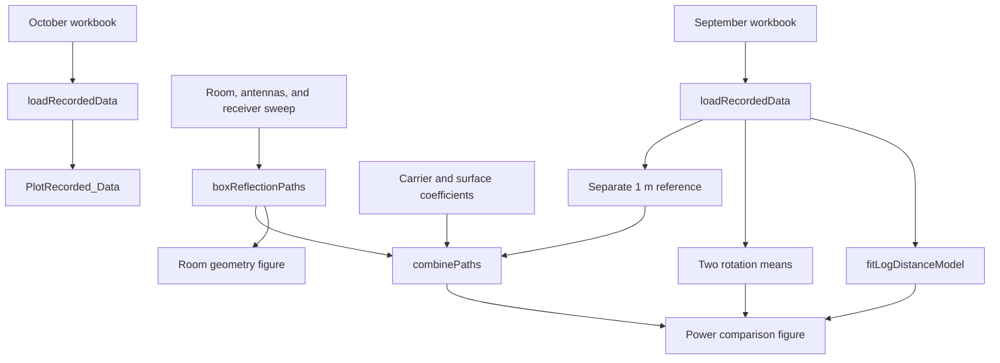

# Code guide: running and understanding The Box

This document follows the MATLAB implementation from recorded samples to predicted received power. Read the [educational primer](BACKGROUND.md) for the underlying physics and step-by-step equation derivations.

## 1. Run the project

Open MATLAB with this repository as the current directory, then run:

```matlab
testBoxModel
TheBox_SIMULATION
PlotRecorded_Data
```

Base MATLAB is sufficient; the spreadsheets are read using `readcell`. The implementation does not require the original RF or Statistics toolbox functions.

`testBoxModel` runs numerical checks. `TheBox_SIMULATION` clears workspace variables, closes existing figures, and creates a power-comparison figure and a room-geometry figure. `PlotRecorded_Data` creates a separate plot of October measurements and leaves existing figures open.

The scripts locate spreadsheets relative to their own file locations using `mfilename('fullpath')` and `fileparts`. Their helper functions must also be on MATLAB's path; running from the repository directory satisfies that requirement.

## 2. How the files connect



The geometry function supplies lengths. The signal function turns those lengths and reflection coefficients into a coherent amplitude sum. The measurement fit is a separate comparison curve; its parameters do not control the ray model.

| File | Role |
|---|---|
| [`TheBox_SIMULATION.m`](TheBox_SIMULATION.m) | Main configuration, receiver sweep, and comparison figures |
| [`loadRecordedData.m`](loadRecordedData.m) | Workbook parsing, unit conversion, decoding, and statistics |
| [`boxReflectionPaths.m`](boxReflectionPaths.m) | Direct and six single-reflection path lengths and points |
| [`combinePaths.m`](combinePaths.m) | Complex-amplitude sum and received-power conversion |
| [`fitLogDistanceModel.m`](fitLogDistanceModel.m) | Least-squares measured trend |
| [`PlotRecorded_Data.m`](PlotRecorded_Data.m) | Dense October measurement plot |
| [`plotBoxModel.m`](plotBoxModel.m) | Room and antenna visualization |
| [`plotcube.m`](plotcube.m) | Rectangular surface drawing helper |
| [`testBoxModel.m`](testBoxModel.m) | Physical and data regression checks |

## 3. Load the measurements: `loadRecordedData`

### Call and workbook layout

```matlab
data = loadRecordedData('dataCollection_9_10_22.xlsx', 'negative-magnitude');
```

The function expects the historical workbook layout: distances in column 1, ten hexadecimal readings in columns 2 through 11, and a separate row labeled `1 meter`. Readings 1 through 5 form Rotation 1; readings 6 through 10 form Rotation 2. Missing spacer cells are not measurements.

| Workbook | Distance header | Conversion to meters | Sweep rows |
|---|---|---:|---:|
| `dataCollection_9_10_22.xlsx` | Feet (`ft`) | Multiply by 0.3048 | 25 |
| `dataCollection_10_9_22.xlsx` | Inches | Multiply by 0.0254 | 37 |

The function reads the first header to choose a conversion. It selects rows whose first cell is a finite, positive numeric scalar. The text-labeled reference row is therefore excluded from the spatial sweep and handled separately.

This is a loader for these workbooks, not a generic spreadsheet importer. A new layout or radio format may require editing it.

### Decode hexadecimal bytes explicitly

`string(cells)` gives a common text representation for the spreadsheets' mixed numeric and text cells. `hex2dec` interprets those representations as hexadecimal numbers; `reshape` preserves the original sample layout.

The `encoding` argument chooses the conversion to signed dBm:

| Encoding | Rule | Example |
|---|---|---|
| `negative-magnitude` (default) | Negate the decoded number | `2B` becomes 43, then -43 dBm |
| `signed-byte` | Subtract 256 from decoded values at least 128 | `D5` becomes 213, then -43 dBm |

The first option preserves the historical code's apparent interpretation. It is an assumption requiring confirmation from the radio documentation. The second is useful only if the radio actually reports two's-complement dBm bytes. Neither option implements a device-specific offset or arbitrary RSSI scale.

### Returned structure

Let `N` be the number of sweep positions:

| Field | Shape | Meaning |
|---|---|---|
| `distance_m` | N-by-1 | Sweep distances in meters |
| `samplesDbm` | N-by-10 | Individual decoded signed-dBm samples |
| `rotationMeanDbm` | N-by-2 | Mean of each five-reading rotation group |
| `meanDbm` | N-by-1 | Mean of all ten logarithmic readings |
| `powerMeanDbm` | N-by-1 | Mean linear power converted back to dBm |
| `referenceSamplesDbm` | 1-by-10 | Samples from the separate `1 meter` row |
| `referenceDbm` | Scalar | Mean logarithmic reference reading |
| `referenceDistance_m` | Scalar | 1 meter |
| `encoding` | Text | Selected decoding convention |

For example, `mean(data.samplesDbm(:,1:5),2)` selects every row and the first five samples, then averages across columns. The final argument `2` means the second array dimension, not the second rotation.

The two rotation means stay separate in both plots. `meanDbm` combines them only for the descriptive measured trend. `powerMeanDbm` is available for analysis but is not used in the default plots.

Under the default decoding, September spans 0.9144 to 8.2296 m and its reference is -33 dBm. October spans 3.9624 to 4.8768 m and its reference is -34 dBm.

## 4. Configure the main simulation

The first portion of `TheBox_SIMULATION.m` specifies the scenario:

| Variable | Default | Interpretation |
|---|---|---|
| `room_m` | `[12.7127, 14.0462, 3]` | Room extent along x, y, and z, in meters |
| `txPos_m` | `[2.2479, 7.8486, 1]` | Transmitter coordinates in meters |
| `rxHeight_m` | `1` | Receiver z-coordinate in meters |
| `frequency_Hz` | `2.4e9` | Assumed carrier frequency, in Hz |
| `pathExponent` | `2` | Free-space power-distance exponent for each ray |
| `powerReflectance` | Six values of `0.03` | Illustrative power fraction reflected at each surface |
| `reflectionPhase_rad` | Six values of `pi` | Illustrative reflection phase shifts, in radians |

The height and frequency settings remain assumptions. Set the actual channel center frequency, not just a rounded band label, when available.

The coefficients are constructed with:

```matlab
gamma = [1, sqrt(powerReflectance).*exp(1i*reflectionPhase_rad)];
```

`sqrt` converts each power reflectance to a field magnitude. `exp(1i*...)` gives its complex phase rotation. The `.*` operator multiplies corresponding array elements. The leading `1` represents the direct path, which has no surface reflection.

The six surface entries always follow this order:

| Surface index | Plane | `gamma` index |
|---:|---|---:|
| 1 | x = 0 | 2 |
| 2 | x = room length | 3 |
| 3 | y = 0 | 4 |
| 4 | y = room width | 5 |
| 5 | z = 0 (floor) | 6 |
| 6 | z = room height (ceiling) | 7 |

These constant coefficients are configurable scalar approximations. The code does not calculate Fresnel coefficients from materials or vary a coefficient with incidence angle. The identical 3% and 180-degree defaults are illustrative, not experimentally established surface properties.

`referenceDbm` comes from the separate 1 m row, and `d0_m` is 1. This reference sets an overall scale. Because the measurement was taken in a room, it may already contain interference; it is provisional rather than an isolated direct-path calibration.

## 5. Compute geometry: `boxReflectionPaths`

```matlab
[lengths_m, points_m] = boxReflectionPaths(room_m, txPos_m, rxPos_m);
```

Each input contains three real coordinates or dimensions. The function reshapes them into row vectors. Room dimensions must be positive; transmitter and receiver positions must be finite, distinct, and strictly inside the room. Positions on a wall are rejected.

`lengths_m` is a 1-by-7 vector: direct length followed by six reflected lengths in the order above. `points_m` is a 6-by-3 matrix: each row is one reflection point. There is no reflection-point row for the direct path.

The first length is `norm(tx_m-rx_m)`. The loop then visits each surface:

1. `ceil(surface/2)` chooses coordinate 1, 2, or 3, corresponding to x, y, or z.
2. Odd-numbered surfaces use coordinate zero; even-numbered surfaces use the corresponding room dimension.
3. `imageTx(axisIndex) = 2*wall-tx_m(axisIndex)` mirrors the transmitter coordinate through the plane.
4. `direction = rx_m-imageTx` points from the image to the receiver.
5. `fraction = (wall-imageTx(axisIndex))/direction(axisIndex)` solves where that segment intersects the plane.
6. `point = imageTx+fraction*direction` produces the reflection point.
7. The assertions check that the intersection is on the segment and inside the finite surface. A tolerance of `1e-10*max(room_m)` meters allows tiny floating-point errors in the bounds check.
8. `norm(direction)` gives the unfolded reflected length.

The formula for the intersection is the axis-aligned specialization of the plane equation in the primer. With both antennas strictly inside this convex rectangular room, each image-to-receiver segment crosses its associated plane. The function does not inspect furniture or other obstacles.

The general image method supports unequal antenna heights and motion along arbitrary directions. The main script uses only one particular route.

## 6. Combine the rays: `combinePaths`

```matlab
[receivedDbm, h] = combinePaths(lengths_m, gamma, frequency_Hz, ...
    referenceDbm, n, d0_m);
```

The length vector and coefficient vector must have equal numbers of entries. They may describe any number of paths; the seven-path limit belongs to the room geometry function. Lengths, frequency, exponent, and reference distance must be positive. Coefficients may be complex; the function does not enforce passive-surface bounds on their magnitudes.

After input validation, the function converts both vectors to rows with `(:).'`. The dot before the transpose matters: it transposes without complex conjugation, preserving reflection phases.

The wavenumber is:

```matlab
k = 2*pi*frequency_Hz/299792458;
```

The speed is in meters per second and frequency is in cycles per second, giving `k` in radians per meter. The core sum is:

```matlab
h = sum(gamma .* (d0_m./lengths_m).^(n/2) .* ...
    exp(-1i*k*(lengths_m-lengths_m(1))));
```

Read it from the individual factors:

- `d0_m./lengths_m` forms each reference-to-path distance ratio.
- `.^` raises each ratio separately to the amplitude exponent `n/2`.
- `exp(...)` supplies each path's propagation phase relative to the first path.
- Multiplication by `gamma` adds reflection attenuation and phase.
- `sum` combines all complex path amplitudes, retaining interference between every pair.

Removing the first path's common phase does not change power. The returned `h` is dimensionless and uses that relative phase convention; it is not an absolute-phase channel response referenced to transmitter time.

Finally:

```matlab
receivedDbm = referenceDbm+20*log10(abs(h));
```

`abs(h)` is the combined amplitude magnitude. The factor 20 converts that amplitude ratio into a power-level difference. Exact cancellation yields `-Inf`; no noise floor is added. A finite measured floor would require a receiver/noise model rather than a cosmetic clamp.

A minimal example independent of the workbooks is:

```matlab
[pDbm, h] = combinePaths([1, 1], [1, 1], 2.4e9, -33, 2, 1);
% h = 2, pDbm approximately -26.98: two identical in-phase arrivals.
```

## 7. Fit the measured trend: `fitLogDistanceModel`

```matlab
[A, n] = fitLogDistanceModel(rssiDbm, dist_m, d0_m);
```

`d0_m` defaults to 1 when omitted. Inputs are signed dBm and positive distances. At least two distinct distances are required. **This signed-dBm contract differs from the original version's positive-magnitude convention.**

The function forms a two-column design matrix and solves for its coefficients:

```matlab
b = [ones(size(dist_m)), -10*log10(dist_m/d0_m)] \ rssiDbm;
```

Every row represents one measurement. The column of ones multiplies the unknown reference level. The second column multiplies the unknown exponent. MATLAB's backslash operator solves the least-squares problem without explicitly constructing a matrix inverse.

`b(1)` becomes the reference level `A` in dBm; `b(2)` becomes `n`. The helper does not constrain the fitted exponent to be positive: it reports the unconstrained measured trend. In contrast, the ray-combination function requires a positive configured spreading exponent.

For September, the default decoding gives approximately `A = -38.638603` dBm and `n = 1.257285`. These parameters only draw the measured-trend curve. They do not replace `referenceDbm` or `pathExponent` in the ray model.

## 8. Follow the receiver sweep and read the figures

The script creates distances from the smallest to largest September measurement. `linspace` includes both endpoints, with enough points that the spacing is no greater than 0.005 m. This makes the model curve smooth; it does not create new experimental observations.

For each distance, the receiver is placed at:

```matlab
rxPos_m = [txPos_m(1)+distance_m(index), txPos_m(2), rxHeight_m];
```

Because the configured transmitter and receiver heights match, the x-offset is also their Euclidean separation. If you change receiver height, the offset no longer equals actual Tx-Rx distance; update the sweep, horizontal-axis interpretation, and baseline distance calculations together.

At each point, geometry supplies seven lengths and `combinePaths` supplies one predicted power. Two additional curves are calculated outside the loop: the configured direct-path-only power and the independent fitted measurement trend.

The power figure contains:

| Plot entry | What it represents |
|---|---|
| LOS + six reflections | Coherent prediction using configured ray parameters |
| Direct path only | Reference-scaled inverse-square baseline with no reflections |
| Fitted measured trend | Smooth empirical summary of the measured logarithmic means |
| Rotation 1 mean | Five-reading logarithmic mean at each measured position |
| Rotation 2 mean | The other five-reading logarithmic mean |

The geometry figure uses the median recorded distance, draws Tx and Rx, shows the direct route as a dashed line, and draws the six reflected routes. Labels 1 through 6 match the surface order. It is one representative position, not an animation or a field-strength map.

`plotBoxModel` calls `plotcube` to draw the room, adds antenna markers, and sets equal axis scaling and meter labels. Neither drawing function participates in path or power calculations.

## 9. Plot the October experiment

`PlotRecorded_Data.m` loads the October workbook with the same explicit decoding convention, then plots each rotation mean against distance. It does not predict October power or assume October reused September's room and antenna coordinates.

The one-inch spacing provides denser spatial information than September's one-foot spacing. Before comparing it to a simulated curve, establish the actual geometry, route, carrier, and orientations for that collection.

## 10. What the checks establish

`testBoxModel` checks mathematical properties and known data values:

- Inverse-square direct-path power, coherent gain, exact cancellation, complex phase, and half-wavelength propagation effects.
- Invariance of power when paths are reordered or receive a common phase rotation.
- Zero-coefficient paths contributing no signal.
- Finite reflection points, equal-angle reflection, unfolded path lengths, and transmitter-receiver reciprocity for unequal heights and general positions.
- Agreement with midpoint projection in the original symmetric special case.
- Rejection of selected invalid inputs.
- Recovery of known log-distance parameters, including a non-unit reference distance.
- Historical workbook shapes, distance conversions, reference levels, rotation differences, and fitted parameters.

The workbook regression checks preserve the known historical data interpretation. They do not verify the radio's real encoding or establish that the model predicts a physical room accurately. The alternative signed-byte check exercises that branch on the existing low-valued bytes; it does not use a historical byte above 127.

## 11. Experimental assumptions and next changes

The first quantitative comparison should confirm RSSI encoding, actual carrier frequency, antenna locations and orientations, room dimensions, and independent reference scaling. September's rotation means differ by up to 11 dB at the same distance, while its fitted 1 m trend differs from the separately recorded reference by about 5.64 dB. These observations justify retaining the measurements and calibration choices explicitly.

After those inputs are established, surface-specific coefficients, antenna responses, additional bounces, or a bandwidth-aware model can be added as the experiment warrants. The current implementation is scalar and narrowband; it contains no automatic material estimation, polarization tracking, obstruction detection, or congestion diagnosis. The [primer's discussion of model limits](BACKGROUND.md#10-where-the-approximation-ends) explains why those extensions can matter.
